# LL-Java-Zip 读写算法分析

> libjzip 各 reader/writer/mapper 的算法流程。类关系与字段模型见 [MODEL.md](MODEL.md)。

---

## 1. ZIP 格式概述

一个标准 ZIP 文件的布局：

```
[Local File Header 1]
[File Data 1]
[Local File Header 2]
[File Data 2]
...
[Central Directory Header 1]
[Central Directory Header 2]
...
[End of Central Directory]
[ZIP64 End of Central Directory Locator]
[ZIP64 End of Central Directory]
```

每个段的签名（LE uint32）：

| 段 | 签名 | 十六进制 |
|---|---|---|
| Local File Header (LOC) | `PK\x03\x04` | `0x04034b50` |
| Central Directory Header (CEN) | `PK\x01\x02` | `0x02014b50` |
| End of Central Directory (EOCD) | `PK\x05\x06` | `0x06054b50` |
| ZIP64 EOCD Locator | `PK\x06\x07` | `0x07064b50` |
| ZIP64 EOCD Record | `PK\x06\x06` | `0x06064b50` |

### EOCD 结构（固定 22 字节 + 注释）

```
偏移  大小  字段
0     4    签名 (0x06054b50)
4     2    所在磁盘编号
6     2    中央目录起始磁盘
8     2    本磁盘上 CEN 条目数
10    2    CEN 总条目数
12    4    CEN 总大小
16    4    中央目录偏移量
20    2    注释长度
22    ?    注释
```

---

## 2. 三种读取策略

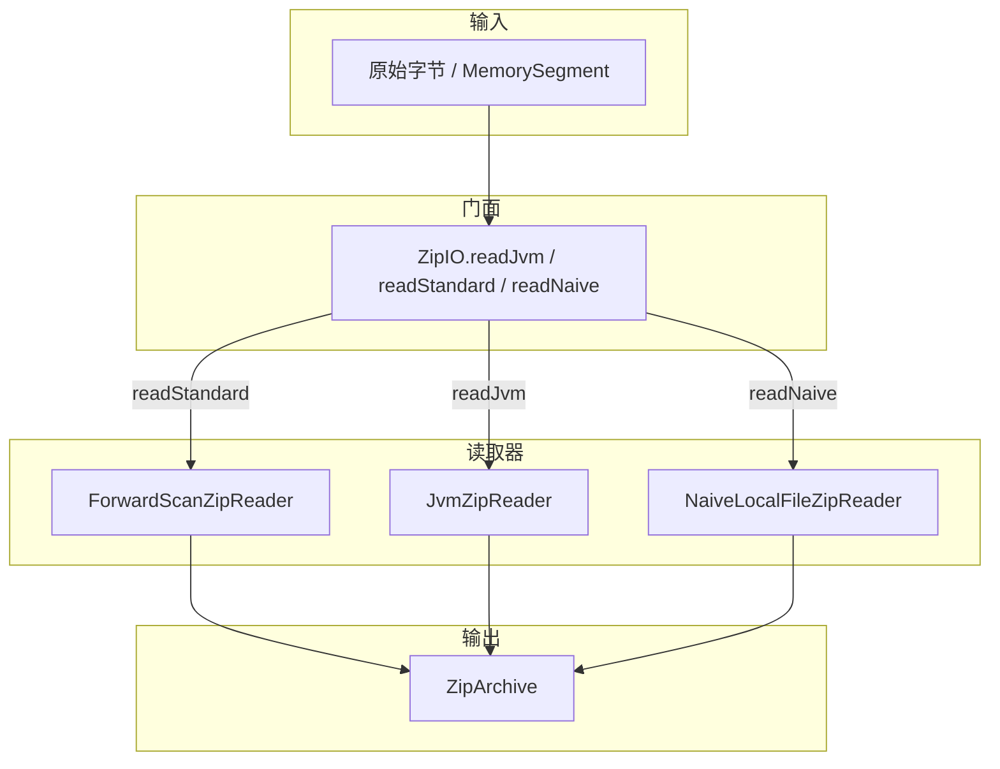

| 特征 | ForwardScanZipReader | JvmZipReader | NaiveLocalFileZipReader |
|---|---|---|---|
| EOCD 搜索方向 | **正向**从文件头 | **反向**从文件尾 | 不需要 EOCD |
| EOCD 验证 | 无（找到第一个即用） | **3 层结构验证链** | 不需要 |
| CEN 解析 | 受 EOCD 声明范围约束 | 受**验证后** CEN 边界严格约束 | 不需要 |
| LOC 数据读取 | 使用 LOC 字段的 compressed_size | 用"扫描到下一个头"方式 + CEN 覆盖 | 仅 LOC |
| baseOffset 回退 | 不需要 | 有（扫描 PK 签名） | 不需要 |
| 前缀数据 | 支持 | 支持 | 支持 |
| CEN↔LOC 链接 | 双向 | 双向 | 无 CEN |
| ZIP64 | 是 | 是 | 否 |
| 抗伪造 | 低 | 高 | 极低 |

---

### 2.1 ForwardScanZipReader — 正向扫描读取器

**定位**：标准 ZIP 文件解析，按 ZIP 规范布局顺序（LOC→CEN→END）正向扫描。

#### 算法流程

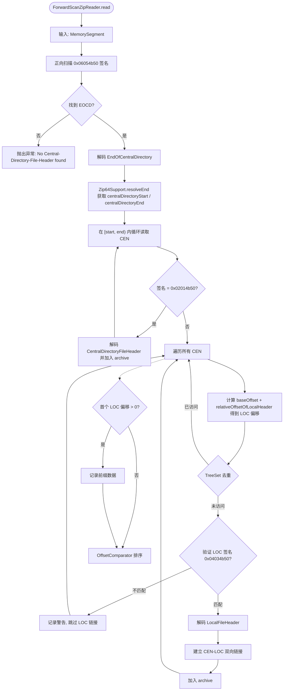

#### 关键设计点

1. **只找第一个 EOCD**：`indexOfQuad` 从偏移 0 开始正向搜索。对于 concat/merged ZIP（多个 ZIP 拼接），这只能看到**第一个** ZIP 的 EOCD。
2. **CEN 边界由 EOCD 声明**：EOCD 声明的 `centralDirectoryOffset` 和 `centralDirectorySize` 直接决定 CEN 扫描范围，不验证其真实性。
3. **LOC 字段原样使用**：LOC 的 `compressedSize`/`uncompressedSize` 直接用于确定文件数据边界。如果 LOC 的 size 字段被篡改，读取会出错。
4. **CEN→LOC 映射靠 CEN 的 offset 字段**：CEN 条目的 `relativeOffsetOfLocalHeader` 加上 baseOffset（通常为 0）决定 LOC 的绝对位置。
5. **前缀数据**：首个 LOC 偏移之前的字节被保留为 `prefixData`（如 exe 启动引导程序等）。

#### 适用场景

- 标准未篡改的 ZIP/JAR 文件
- 需要快速读取且不关心容错的场景

---

### 2.2 JvmZipReader — JVM 语义读取器

**定位**：模拟 HotSpot JVM 的 `java.util.zip.ZipFile` 行为，是 LL-Java-Zip 最复杂、最健壮的读取器。
设计目标是：在**不信任**的/伪造的 ZIP 文件上尽可能恢复数据。

#### 算法全流程

`JvmZipReader.read` 分 5 个阶段（每阶段的细节算法见下方各小节）：

1. **Phase 1 — EOCD 查找与验证**：从未尾 `65535+22` 字节窗口反向扫描 `0x06054b50`，收集所有候选 EOCD；对每个候选执行 `isValidEndHeader`（comment_length 对齐文件尾则直接接受，否则做结构验证：CEN 签名 / LOC 签名 / NameLen 一致性），选第一个通过的候选；全部失败则抛 `No valid EOCD found`。
2. **Phase 2 — CEN 严格解析**：在 `[centralDirectoryStart, centralDirectoryEnd)` 内循环解码 `CentralDirectoryFileHeader`；消耗后必须精确匹配 `centralDirectoryEnd`，否则抛 `CEN 边界不一致`。
3. **Phase 3 — baseOffset 确定与回退**：计算 `jvmBaseFileOffset = endInfo.baseOffset`；若 `hasAnyLinkedLocalHeader` 失败，先试偏移 0 处 LOC 签名（快速路径），再前向扫描 PK 签名（慢速路径）以更新 baseOffset。
4. **Phase 4 — LOC 解析**：填充 `entryOffsets TreeSet`（含 `earliestCdfh` / EOCD 偏移），遍历 CEN 计算绝对 LOC 偏移；HashSet 去重 + LOC 签名校验；通过 `JvmZipPartAllocator` 分配 `JvmLocalFileHeader` 并 `setOffsets(entryOffsets)`；从字节读取 LOC（异常静默捕获）→ CEN-LOC 双向链接 → `adoptLinkedCentralDirectoryValues` → 加入 archive。
5. **Phase 5 — 收尾**：记录 `prefixData`，`OffsetComparator` 排序。

#### 3 层 EOCD 验证链

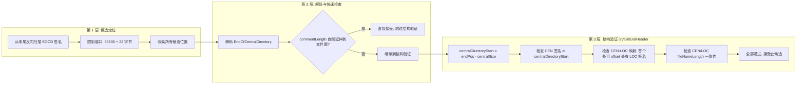

`isValidEndHeader` 是 JVM 行为的逆向工程产物：
- 它防止嵌入在注释/数据/尾部填充中的**虚假 EOCD 签名**被误接受
- JVM 不会接受一个声称的 CEN 范围与其头部内容不匹配的 EOCD
- 这解释了为何某些样本（如 `hello-end-declares-0-entries.jar`）在 JVM 读取器下能恢复数据

#### CEN→LOC 映射回退

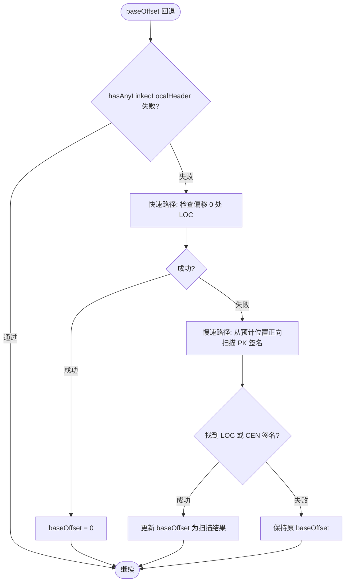

#### "扫描到下一个头"文件数据读取

`JvmLocalFileHeader` 的核心创新——不信任 LOC 的 `compressedSize`/`uncompressedSize`：

```
已知当前 LOC 偏移 -> 计算数据起始偏移 -> 在 entryOffsets 中查找
下一个偏移 (ceiling) -> 数据结束 = nextOffset - sizeof(DD if bit3 set)
```

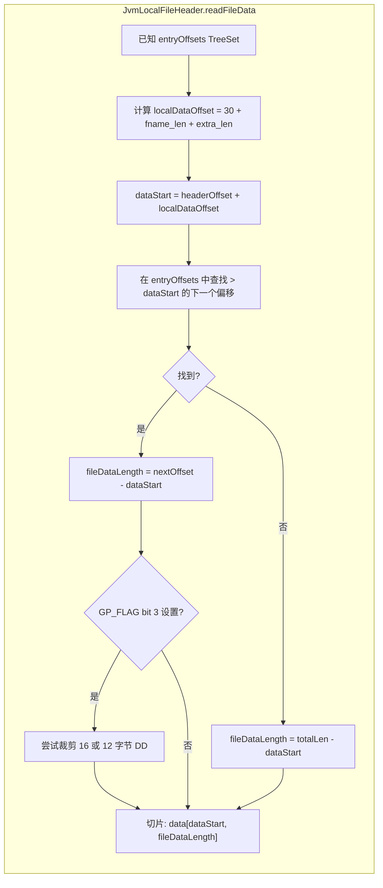

#### CEN 值覆盖（adoptLinkedCentralDirectoryValues）

JVM 信任 CEN 而非 LOC。解析 LOC 后，调用 `adoptLinkedCentralDirectoryValues` 会用 CEN 的以下字段覆盖 LOC：

| 字段 | 覆盖规则 |
|---|---|
| `versionNeededToExtract` | 从 CEN 复制 |
| `generalPurposeBitFlag` | 从 CEN 复制 |
| `compressionMethod` | 从 CEN 复制 |
| `crc32` | 从 CEN 复制 |
| `compressedSize` | 从 CEN 复制 |
| `uncompressedSize` | 从 CEN 复制 |
| `fileName` | 从 CEN 复制 |
| `extraField` | 从 CEN 复制 + 追加 CEN extra 字段 |
| **文件数据切片** | 使用 CEN 的 compressedSize 重新切片 |

#### 适用场景

- JAR/WAR/APK 等可能被篡改的归档
- concat/merged ZIP（多 ZIP 拼接，取最后一个有效 ZIP）
- 需要抗伪造能力的场景

---

### 2.3 NaiveLocalFileZipReader — 朴素读取器

**定位**：最简单的读取器，只用 LOC 签名，完全不依赖 EOCD 和 CEN。

#### 算法流程

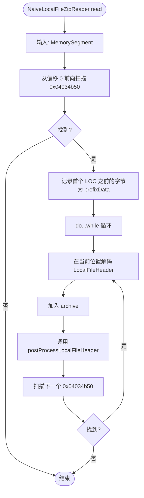

#### 关键设计点

- **无结构验证**：只找 LOC 签名，不检查 EOCD/CEN 的任何内容
- **无去重**：同一个字节序列如果有多个 LOC 签名重叠匹配，会被多次读取
- **不返回错误**：找不到 LOC 时返回空 `ZipArchive`，不抛异常

#### 适用场景

- 流式 ZIP（数据流只有 LOC 头）
- 仅需快速预览文件列表
- 修复严重损坏的 ZIP（EOCD 和 CEN 完全丢失）

---

## 3. 写入策略

### 3.1 DirectZipWriter — 直接写入器

将 `ZipArchive` 的模型字段逐字写出，不做重压缩。

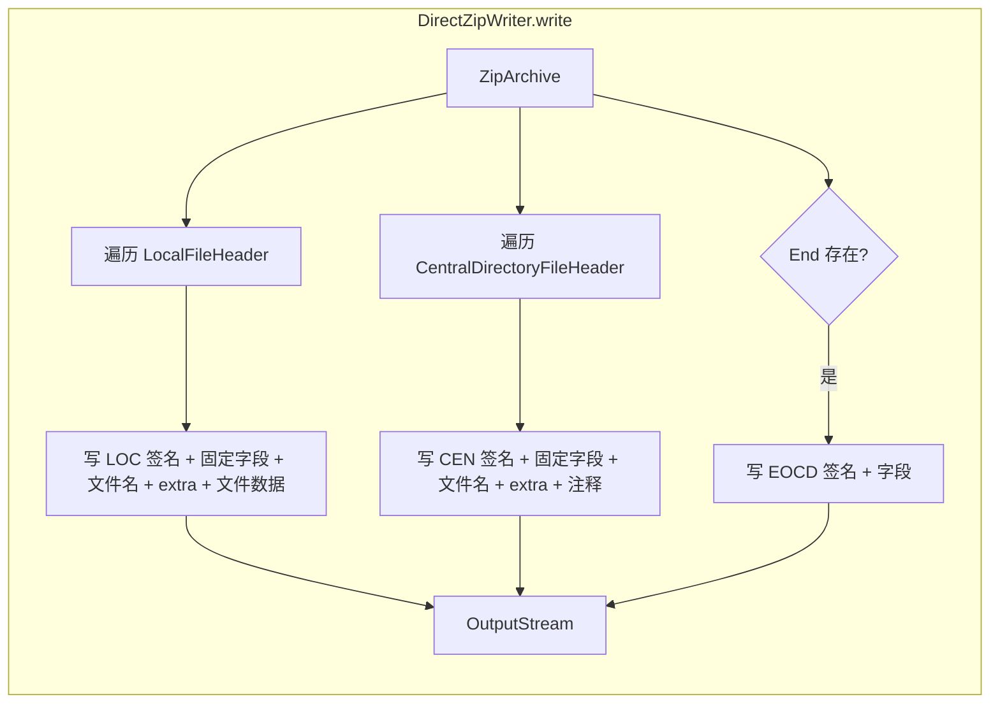

**写入顺序**：`LOC block -> CEN block -> END record`

**特点**：
- 不重压缩，不重新计算 CRC32
- LOC 和 CEN 的 `relativeOffsetOfLocalHeader` 必须提前正确
- 常用于调试/测试，或需要逐字复制的场景

### 3.2 ZipOutputStreamZipWriter — 重压缩写入器

通过 Java 内置 `ZipOutputStream` 重新写入，始终解压后重新压缩。

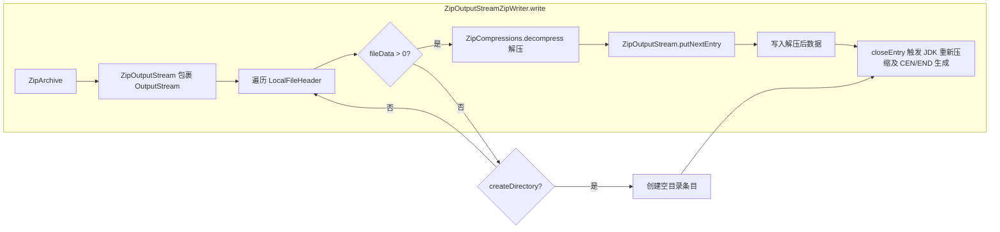

**与 DirectZipWriter 对比**：

| 特征 | DirectZipWriter | ZipOutputStreamZipWriter |
|---|---|---|
| 压缩 | 保持原始 method | 解压→JDK 重压缩 |
| CEN/END | 从模型写出 | JDK 重新生成 |
| 字节级重现 | 是 | 否 |
| 输出兼容性 | 依赖模型准确性 | 始终生成标准 ZIP |

---

## 4. CEN↔LOC 链接机制

读取器在解码 LOC 后立即建立双向链接（`cdfh.link(lfh)` / `lfh.link(cdfh)`）。

链接在以下场景中使用：

1. **CentralAdoptingMapper**：遍历 CEN 找到链接的 LOC，用 CEN 字段覆盖 LOC
2. **`hasDifferentValuesThanCentralDirectoryHeader()`**：逐字段比较 LOC 和 CEN，检测不一致
3. **`adoptLinkedCentralDirectoryValues()`**：用 CEN 字段修复 LOC

> 链接的字段语义与生命周期见 [MODEL.md](MODEL.md) §3.2。

---

## 5. Data Descriptor 处理

Data Descriptor 是 ZIP 规范 §4.3.9 定义的可选结构，位于文件数据之后。
当 `generalPurposeBitFlag` 的 bit 3 设置时，LOC 的 CRC32/size 字段为 0，真实值在 DD 中。

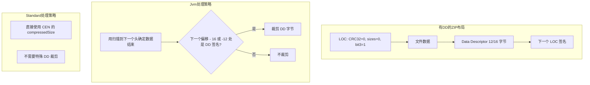

**DD 格式**：

```
有签名 (16 字节)         无签名 (12 字节)
0x08074b50               (无签名)
CRC32 (4 字节)           CRC32 (4 字节)
compressedSize (4/8)     compressedSize (4/8)
uncompressedSize (4/8)   uncompressedSize (4/8)
```

---

## 6. Mapper 体系

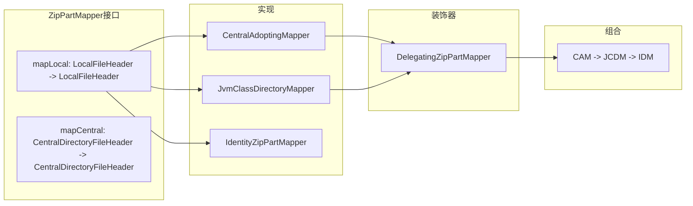

使用方式：

```java
ZipArchive mapped = archive.withMapping(
    new CentralAdoptingMapper(
        new JvmClassDirectoryMapper(
            new IdentityZipPartMapper())));
```

### CentralAdoptingMapper

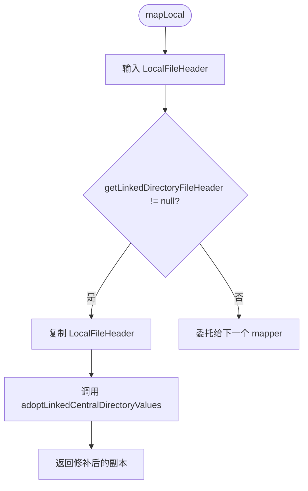

### JvmClassDirectoryMapper

修复 JVM 在某些情况下遗留的尾部斜杠（`Hello.class/` → `Hello.class`）：

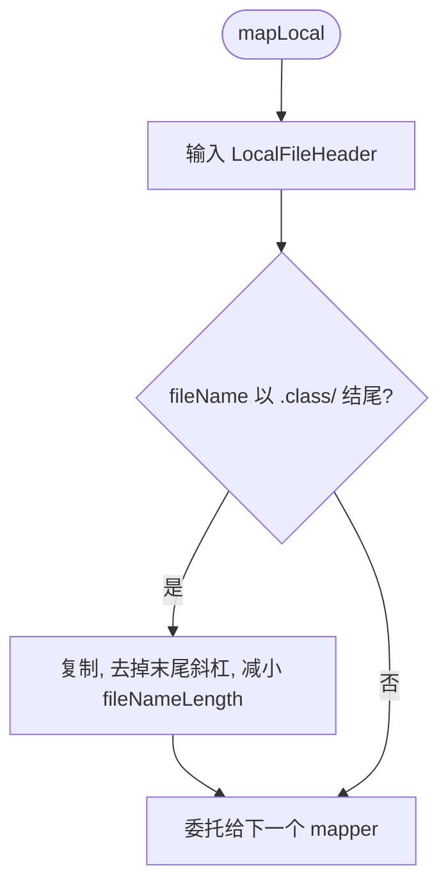

---

## 7. ZIP64 支持

ZIP64 用于处理超过 65535 个条目或超过 4GiB 的归档。在 LL-Java-Zip 中由 `Zip64Support.java` 处理。

### ZIP64 触发条件

- CEN 条目数 = `0xFFFF`
- LOC/CEN 的 size 字段 = `0xFFFFFFFF`
- CEN 的 offset 字段 = `0xFFFFFFFF`

### 解析流程

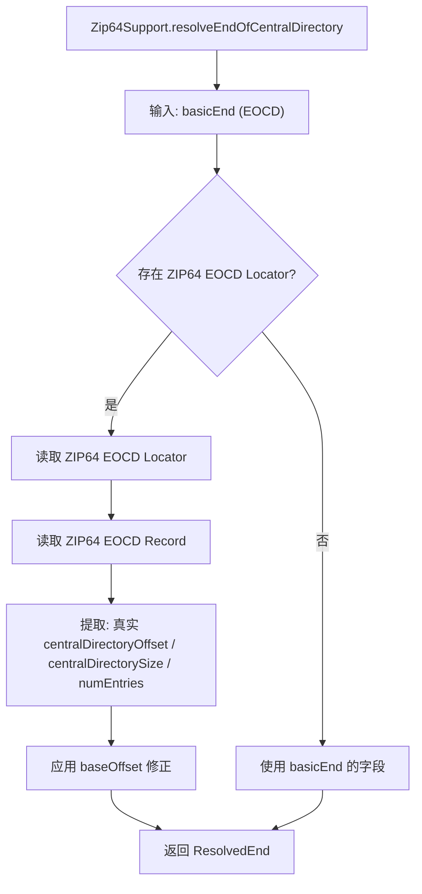

### CEN→LOC 映射的回退

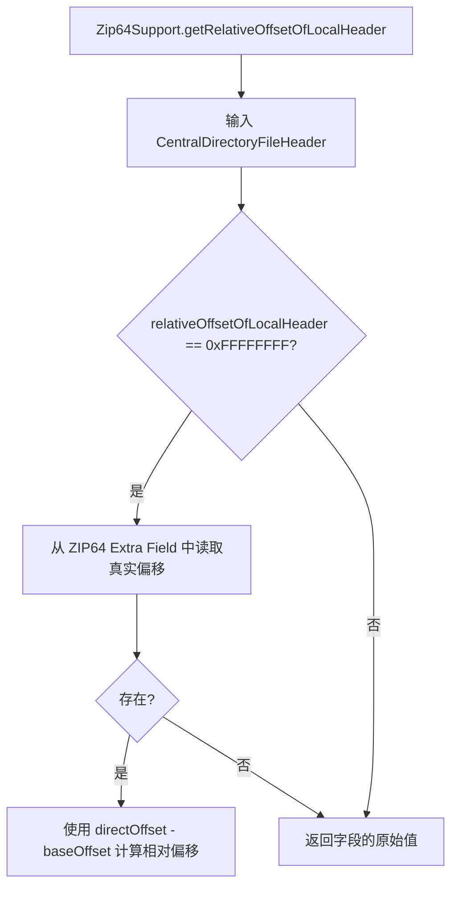

---

## 8. 三大策略对比

| 场景 | ForwardScanZipReader | JvmZipReader | NaiveLocalFileZipReader |
|---|---|---|---|
| 标准 ZIP/JAR | ✅ 最优 | ✅ 可用 | ✅ 可用 |
| Concat/Merged ZIP | ❌ 只读到第一个 | ✅ 读到最后一个 | ❌ 读到所有混在一起 |
| EOCD 被篡改 | ❌ 失败 | ✅ 尝试恢复 | ❌ (不需要 EOCD) |
| CEN 被篡改 | ❌ 失败 | ✅ CEN 覆盖修复 | ❌ (不需要 CEN) |
| LOC size 字段为 0 | ❌ 读不出数据 | ✅ 扫描下一个头 | ❌ 读不出 |
| Data Descriptor | ✅ 用 CEN size | ✅ 扫描 + DD 裁剪 | ❌ 忽略 |
| ZIP64 | ✅ 是 | ✅ 是 | ❌ 否 |
| 抗伪造 | 低 | **高** | 极低 |

---

## 9. 异常模型

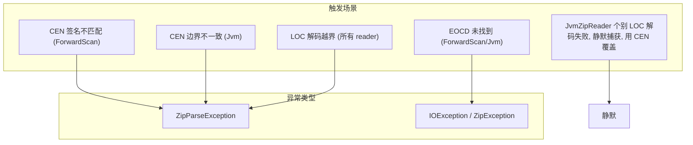

### JvmZipReader 的特殊容错

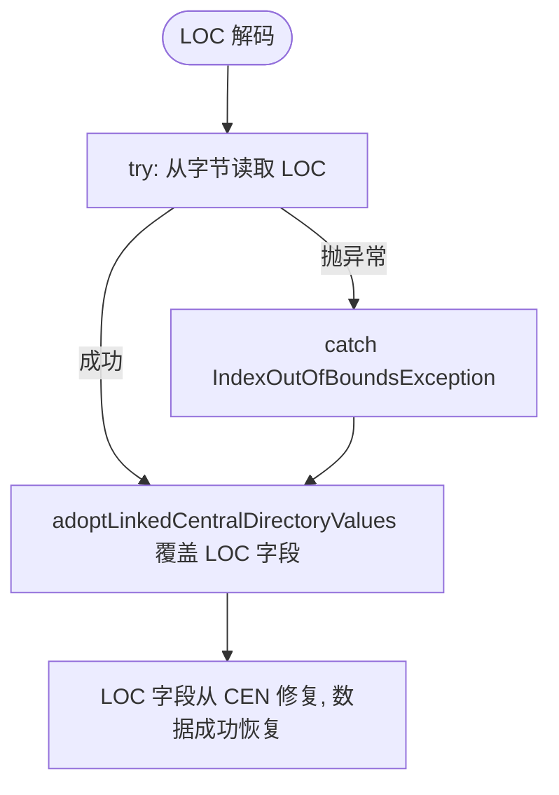

---

## 10. 核心原则

1. **CEN 权威**：Central Directory 是元数据的权威来源，LOC 的字段可以有偏差
2. **JVM 行为为准**：遇到歧义时，以 `java.util.zip.ZipFile` 的行为为准
3. **反向 EOCD**：从文件末尾反向扫描，而非正向
4. **DD 裁剪**：当 bit 3 设置时，用 next-header 扫描确定数据范围，裁剪 DD 字节
5. **容错性**：容忍 leading/trailing garbage、偏移偏差、zero-length locals、尾部斜杠类名
