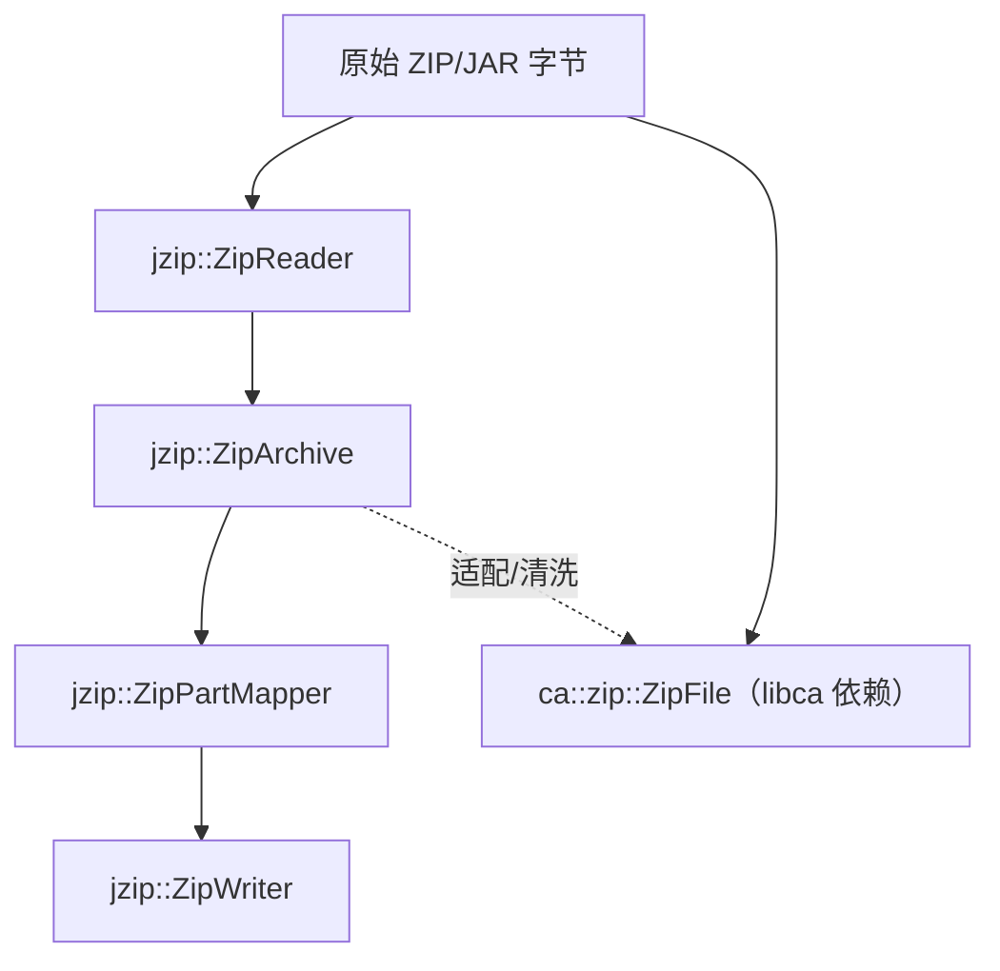

# libjzip 设计文档

## 1. 定位

`libjzip` 是面向 JVM 字节码场景的 ZIP/JAR 基础库，围绕两个抽象层级设计：

- `jzip`（本仓 `src/jzip/`）：保留 ZIP 原始结构，行为对齐 LL-Java-Zip / JVM
- `zip`（依赖包 libca 提供，`ca::zip`）：接近 `java.util.zip` 的简单读写接口

这两层不是重复实现，而是不同抽象层级：

- `jzip` 关心 `LOC / CEN / EOCD / data descriptor / ZIP64 / prefix junk`
- `zip` 关心“按 entry 读写内容”

`jzip` 的 `AdaptingZipReader` 直接委托 `ca::zip::ZipFile`，把结构化模型适配到
简单接口语义（见 §8）。

## 2. 分层结构

```text
src/jzip/                     （本仓）
├── zip_model.hpp             ZIP 结构模型
├── zip_reader.hpp            结构化读取器
├── zip_writer.hpp            结构化写入器
├── zip_mapper.hpp            结构映射器
└── zip_adapting_reader.hpp   委托 ca::zip 的适配读取器

libca/zip/                    （依赖包 libca，版本锁见 xmake.lua）
├── file.hpp                  stdlib 风格随机访问读取（ca::zip::ZipFile）
├── entry.hpp                 entry 元数据
└── ...                       流式读写等其余 stdlib 风格接口
```

## 3. 架构图



## 4. `jzip` 层：结构化模型

`jzip` 的中心对象是 `zip_model.hpp` 里的 `jzip::ZipArchive`。

它持有一组 `ZipPart`，主要有三类：

- `LocalFileHeader`
- `CentralDirectoryFileHeader`
- `EndOfCentralDirectory`

关键点：

- `LocalFileHeader` 和 `CentralDirectoryFileHeader` 可以双向链接。
- `JvmLocalFileHeader` 是 `LocalFileHeader` 的 JVM 语义变体，用于 LOC/CEN 不一致时按 JVM 规则回读。
- `ZipArchive` 保留前缀数据 `prefixData`，因此可以处理前面带 junk 或拼接数据的样本。

## 5. `jzip` 层：读取策略

`zip_reader.hpp` 里有三种 reader：

### `ForwardScanZipReader`

适合标准 ZIP。按常规布局顺序找 EOCD 和 CEN。

特点：

- 行为更接近“规范 ZIP”
- 对 trick 样本容忍度不如 JVM reader

### `JvmZipReader`

这是 `libjzip` 默认最重要的 reader，目标是贴近 JVM/libzip 的现实行为。

特点：

- 从文件尾反向找 EOCD
- 支持 base offset 回退和 CEN/LOC 重新链接
- 遇到字段不一致时更偏向以 CEN 为权威
- 适合 JAR、拼接归档、畸形样本

### `NaiveLocalFileZipReader`

只扫 LOC，不依赖 CEN 和 EOCD。

适合：

- 调试
- 极端损坏样本的兜底读取
- 验证“只看 local headers 能读到什么”

## 6. `jzip` 层：写入策略

`zip_writer.hpp` 里有两条主要写出路径：

### `DirectZipWriter`

直接按 `ZipArchive` 当前结构写回。

适合：

- 尽量保留原结构
- 修改少量元数据后回写
- 需要保留重复 entry、原始 method、原始布局

这类 writer 的正确性依赖 `LOC <-> CEN` 链接关系。最近修复的一个关键问题就是重复文件名时不能只按名字找第一个 LOC，而要按 CEN->LOC 实际链接写回。

### `RecompressingZipWriter`

解压后重写成新 ZIP。

适合：

- 生成干净输出
- 主动规范化结构
- 不需要保留原始压缩布局

它不静默丢条目：源 method 只支持 stored(0)/deflate(8)，其他值直接抛 `ZipParseException`；零字节普通文件照常写出，`createDirectoryEntries` 只控制名字以 `/` 结尾的目录条目是否保留。deflate 解压受 `defaultEntryOutputCap`（min(1 GiB, 压缩大小 × 1000)，下限 1 MiB）限制，防止压缩炸弹。

## 7. `jzip` 层：mapper

`zip_mapper.hpp` 提供对 `ZipArchive` 中部件的映射。

常用 mapper：

- `IdentityZipPartMapper`：不改
- `CentralAdoptingMapper`：让 LOC 采用 CEN 值
- `JvmClassDirectoryMapper`：修正 `.class/` 目录名这类 JVM 特殊情况
- `CopyingZipPartMapper`：按类型调用 `copy()` 返回独立副本；副本不保留 LOC/CEN 互链，JVM 派生的 LOC 退化为基类副本，故应放在映射链末端（后续建立 link 的 mapper 会指向已释放的原部件）

典型链路是：

1. reader 读出 `ZipArchive`
2. mapper 做标准化或复制
3. writer 写回

## 8. `zip` 层：stdlib 风格封装（libca 提供）

本仓不含独立 `zip` 层：按 entry 的易用读写由依赖包 libca 的 `ca::zip` 提供
（对标 `java.util.zip` 的 `ZipFile` 等接口，方法清单与签名直接查 libca 头文件，
版本锁见根目录 `xmake.lua`）。

`jzip` 与该层的桥接点是 `AdaptingZipReader`（`zip_adapting_reader.hpp`）：
委托 `ca::zip::ZipFile` 读取，把条目解压为 method=stored 的干净结构并入
`jzip::ZipArchive` 模型；`ZipIO::readAdaptingIO` 是其便捷入口。

## 9. 文档导航

- 想理解对象关系：看 [model.md](model.md)
- 想理解 EOCD / CEN / LOC / ZIP64 处理算法：看 [algorithm.md](algorithm.md)
- 想理解容器 trick 分类法与 libjzip 样本挂载：看 [tricks.md](tricks.md)
- 想看项目总览、构建测试：回到根目录 [README.md](../README.md)
