# LL-Java-Zip 数据模型与类关系

> libjzip (C++) 的类型体系与类关系，对照 LL-Java-Zip v2.9.0 设计。
> 算法流程见 [ALGORITHM.md](ALGORITHM.md)。

---

## 1. 整体模块结构

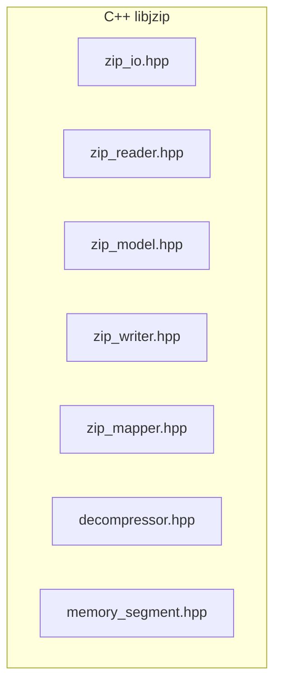

---

## 2. 接口层次体系

### 2.1 核心接口总览

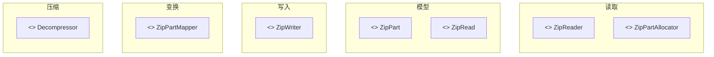

### 2.2 ZipPart 接口

所有 ZIP 结构体的根抽象，派生三类实体。

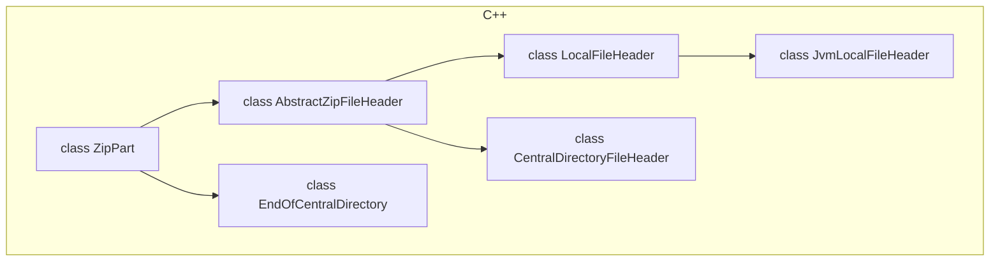

**字段（AbstractZipFileHeader）**：

| 字段 | Java `AbstractZipFileHeader` | C++ `AbstractZipFileHeader` |
|---|---|---|
| `versionNeededToExtract` | `int` | `ca::u16` |
| `generalPurposeBitFlag` | `int` | `ca::u16` |
| `compressionMethod` | `int` | `ca::u16` |
| `lastModFileTime` | `int` | `ca::u16` |
| `lastModFileDate` | `int` | `ca::u16` |
| `crc32` | `int` | `ca::u32` |
| `compressedSize` | `long` (4-byte LE→`int`) | `ca::u32` |
| `uncompressedSize` | `long` | `ca::u32` |
| `fileNameLength` | `int` | `ca::u16` |
| `extraFieldLength` | `int` | `ca::u16` |
| `fileName` | `StringData` | `std::string` |
| `extraField` | `MemorySegmentData` | `std::vector<ca::u8>` |
| `offset` | `long` (transient) | `ca::usize` |

### 2.3 ZipReader 接口

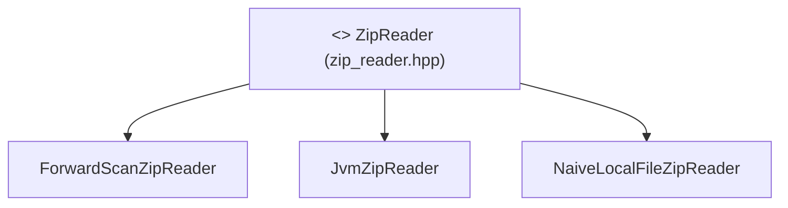

> C++ 简化了继承链，三个 reader 均直接实现 `ZipReader` 接口（Java 版有 `AbstractZipReader` 中间层及依赖 `java.util.zip.ZipFile` 的 `AdaptingZipReader`）。各 reader 的读取算法见 [ALGORITHM.md](ALGORITHM.md) §2。

### 2.4 ZipPartAllocator 接口（工厂模式）

控制 `ZipPart` 子类型的实例化策略。

```java
interface ZipPartAllocator {
    LocalFileHeader newLocalFileHeader();
    CentralDirectoryFileHeader newCentralDirectoryFileHeader();
    EndOfCentralDirectory newEndOfCentralDirectory();
}
```

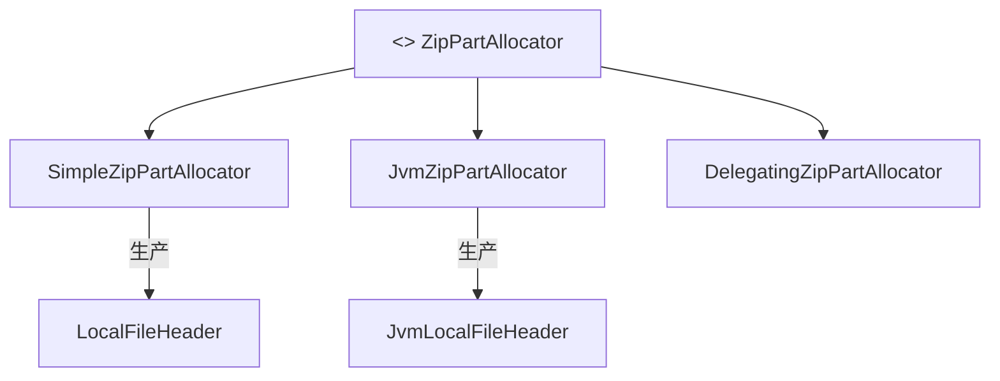

`JvmZipPartAllocator` 与 `JvmZipReader` 配对——它生产 `JvmLocalFileHeader`，后者重写了 `readFileData()` 方法以实现"扫描到下一个头"语义。

### 2.5 ZipPartMapper 接口（装饰器模式）

```java
interface ZipPartMapper {
    LocalFileHeader mapLocal(LocalFileHeader header);
    CentralDirectoryFileHeader mapCentral(CentralDirectoryFileHeader header);
}
```

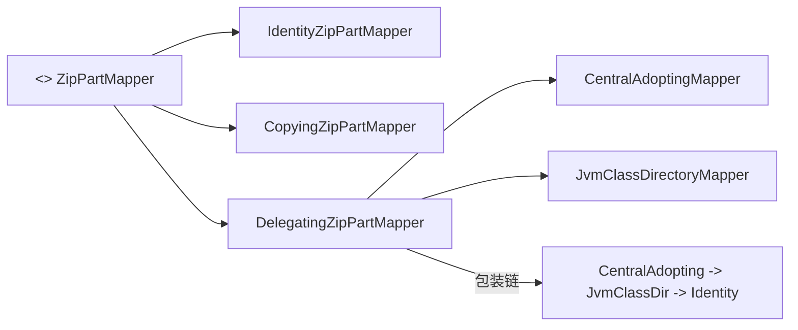

### 2.6 ZipWriter 接口

```java
interface ZipWriter {
    void write(ZipArchive archive, OutputStream os);
}
```

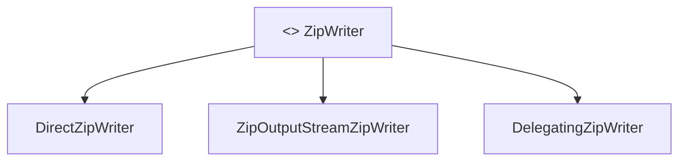

---

## 3. 核心数据模型

### 3.1 ZipArchive（容器）

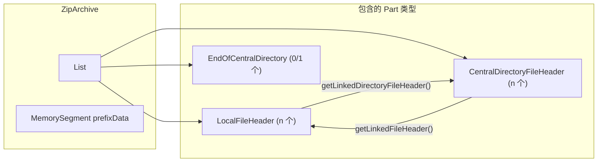

**关键约定**：
- Parts 列表未排序时是无序的（由读取器添加顺序决定）
- `getLocalFiles()` 和 `getCentralDirectories()` 每次遍历全部 parts，按 `PartType` 过滤
- 排序后：`LOC(0) < LOC(1) < ... < CEN(0) < CEN(1) < ... < END`
- Caller 负责 `close()` 释放 memory-mapped file 的 `FileChannel`

### 3.2 双向链接（CEN↔LOC）

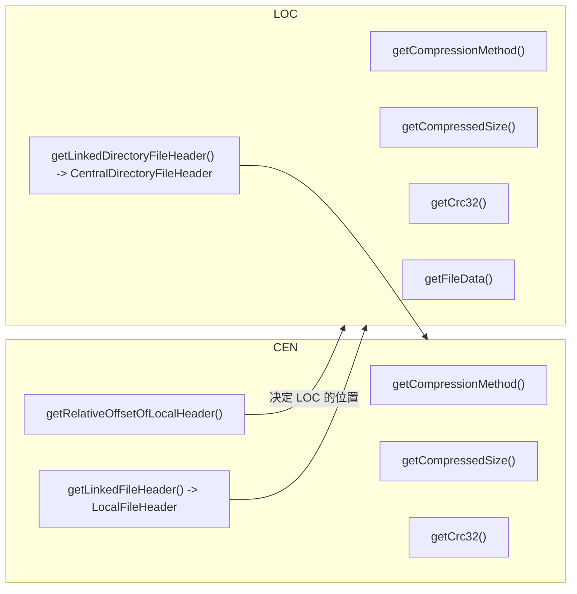

**链接生命周期**：

```
ZipIO.readJvm(data)
  → JvmZipReader.read()
    → 解码 CEN
    → 创建 LOC (JvmLocalFileHeader)
    → cen.link(loc)      // CEN 持有 LOC 指针
    → loc.link(cen)      // LOC 持有 CEN 指针
    → loc.adoptLinkedCentralDirectoryValues()  // 用 CEN 覆盖 LOC
```

### 3.3 数据流的层级

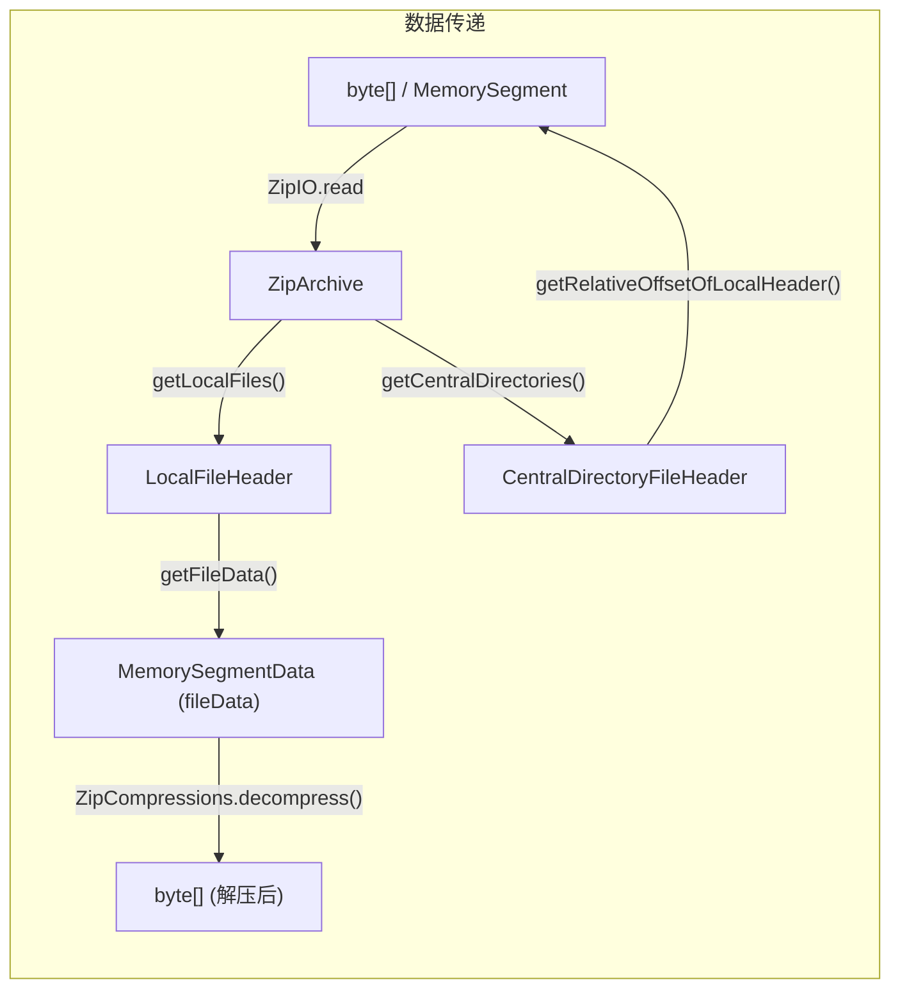

整个过程中**原始字节只读、不复制**（MemorySegment 是视图而非副本）。只有 `decompress()` 产生新的 `byte[]`。

---

## 4. 核心类详析

### 4.1 LocalFileHeader vs JvmLocalFileHeader

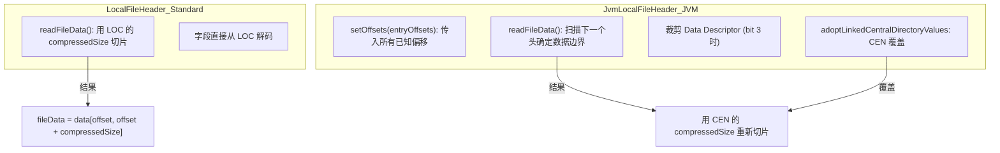

### 4.2 CentralDirectoryFileHeader 独有字段

| 字段 | 类型 | 用途 |
|---|---|---|
| `versionMadeBy` | `ca::u16` | 创建该 ZIP 的软件版本 |
| `fileCommentLength` | `ca::u16` | 文件注释长度 |
| `fileComment` | `std::string` | 文件注释 |
| `diskNumberStart` | `ca::u16` | 条目起始磁盘 (0xFFFF=ZIP64) |
| `internalFileAttributes` | `ca::u16` | 内部属性 (ASCII/binary) |
| `externalFileAttributes` | `ca::u32` | 外部属性 (MS-DOS 权限) |
| `relativeOffsetOfLocalHeader` | `ca::u32` | LOC 在文件中的偏移 (0xFFFFFFFF=ZIP64) |

### 4.3 EndOfCentralDirectory 独有字段

| 字段 | 类型 | 用途 |
|---|---|---|
| `diskNumber` | `ca::u16` | 所在磁盘编号 |
| `centralDirectoryStartDisk` | `ca::u16` | CEN 起始磁盘 |
| `centralDirectoryStartOffset` | `ca::u16` | 本磁盘 CEN 起始偏移 |
| `numEntries` | `ca::u16` | 本磁盘 CEN 条目数 |
| `centralDirectorySize` | `ca::u32` | CEN 总大小 |
| `centralDirectoryOffset` | `ca::u32` | CEN 偏移量 (0xFFFFFFFF=ZIP64) |
| `zipCommentLength` | `ca::u16` | ZIP 注释长度 |
| `zipComment` | `std::string` | ZIP 注释 |

---

## 5. 核心调用关系

### 读取

`ZipIO.readJvm(path)` → `FileChannel.map → MemorySegment` → `JvmZipReader.read(archive, data)`。

`JvmZipReader.read` 内部按 EOCD 查找/验证 → CEN 解析 → baseOffset 回退 → LOC 解析 → 双向链接 → `adoptLinkedCentralDirectoryValues` 的顺序推进，最终 `archive.sort(OffsetComparator)` 后返回。详细流程见 [ALGORITHM.md](ALGORITHM.md) §2.2。

### 写入

`DirectZipWriter.write` 遍历 `getLocalFiles()` 写 LOC 块、遍历 `getCentralDirectories()` 写 CEN 块、最后写 EOCD（若存在）。字段写出顺序为：签名 → version/gpFlag/method/crc32/sizes → fileNameLength/extraFieldLength → fileName/extra → fileData。`RecompressingZipWriter` 则解压后重新压缩。详见 [ALGORITHM.md](ALGORITHM.md) §3。

### withMapping

```
ZipArchive.withMapping(ZipPartMapper mapper)
└── 新 ZipArchive
    ├── 遍历 getLocalFiles():  addPart(mapper.mapLocal(lfh))
    ├── 遍历 getCentralDirectories(): addPart(mapper.mapCentral(cdfh))
    └── 复制 end

CentralAdoptingMapper.mapLocal(lfh)
├── lfh.linkedDirectoryFileHeader != null?
│   ├── 是: 复制 → adoptLinkedCentralDirectoryValues → 返回副本
│   └── 否: 委托给下一个 mapper (delegate.mapLocal())
```

---

## 6. 关键设计模式

### 6.1 工厂模式：ZipPartAllocator

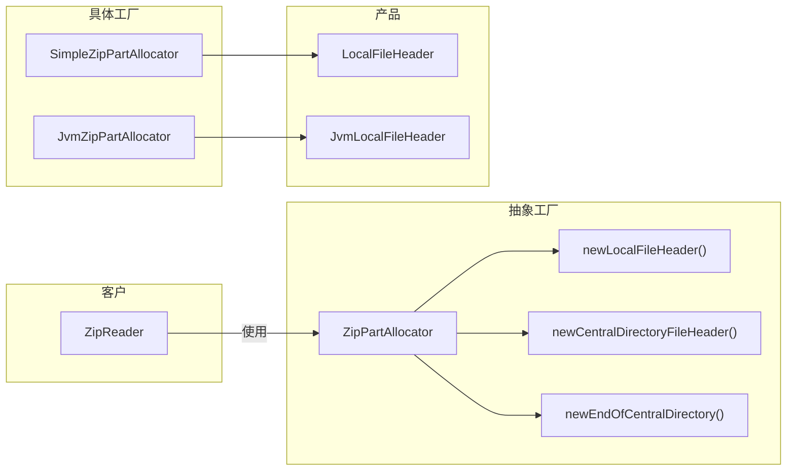

### 6.2 装饰器模式：ZipPartMapper 链

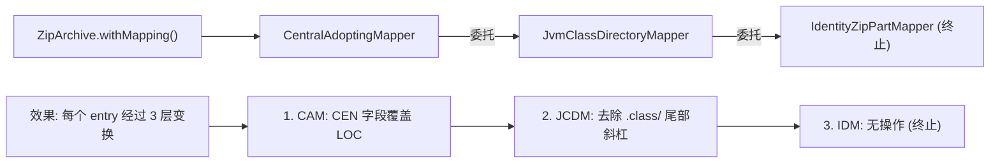

执行顺序（外层先执行，然后委托内层）：
```
mapLocal(lfh)
  → CAM: 检查链接 → 修补 LOC → 委托
    → JCDM: 检查 .class/ → 修改 fileName → 委托
      → Identity: 返回原始
```

### 6.3 单例模式：Decompressor

```java
public class UnsafeDeflateDecompressor implements Decompressor {
    public static final UnsafeDeflateDecompressor INSTANCE = new UnsafeDeflateDecompressor();

    private final Deque<DeflateEntry> pool = new ArrayDeque<>();
    // 最多缓存 64 个 Inflater 实例
}
```

### 6.4 适配器模式：AdaptingZipReader

```java
class AdaptingZipReader {
    void fill(ZipArchive archive, Path path) {
        // 内部委托给 java.util.zip.ZipFile
        // 将 ZipFile 的输出转换为 ZipArchive 格式
        // 使用 FileChannel + LOC 扫描填充 LocalFileHeader 列表
    }
}
```

---

## 7. 状态/异常模型

C++ 中：

```cpp
class ZipParseException : public std::runtime_error {
    ca::usize getOffset() const noexcept;  // 定位错误字节偏移
};
```

触发场景：EOCD 未找到、CEN 签名不匹配、CEN 边界不一致、LOC 解码越界、文件数据边界检查失败。

**JvmZipReader 的静默捕获**：个别 LOC 解码抛出的 `std::out_of_range` 会被静默捕获，随后用 CEN 字段修复 LOC，使数据成功恢复。

---

## 8. 类型映射（数据模型层面）

| Java | C++ | 说明 |
|---|---|---|
| `int` (4-byte LE) | `ca::u32` | unsigned |
| `long` (offset, size) | `ca::usize` | 平台相关 (64-bit) |
| `MemorySegment` | `jzip::MemorySegment` | 视图, 非复制 |
| `MemorySegmentData` | `std::vector<ca::u8>` | 连续内存 |
| `StringData` | `std::string` | UTF-8 |
| `List<ZipPart>` | `std::vector<std::unique_ptr<ZipPart>>` | 所有权明确 |

---

## 9. 模块依赖关系

`zip_io`（门面）→ `zip_reader` / `zip_writer` / `zip_mapper` → `zip_model`；
`zip_reader` / `zip_writer` 还依赖 `decompressor`；所有模块依赖 `memory_segment` 提供的零拷贝视图。

---

## 10. C++ 编码约定

- 命名空间: `jzip`
- 无 RTTI, 使用 `typed::cast<T>()`
- 异常: `ZipParseException` 代替 `IOException`，携带 `offset()` 定位错误
- `MemorySegment` 构造: `MemorySegment(vector)` 或 `MemorySegment(ptr, size)`
- `ZipArchive` 通过 `std::unique_ptr` 管理 `ZipPart` 生命周期；原始字节只读不复制（视图），只有 `decompress()` 产生新 `byte[]`
- 条目查找优先使用 `CentralDirectoryFileHeader` 的 `fileName`（CEN 为权威来源）
